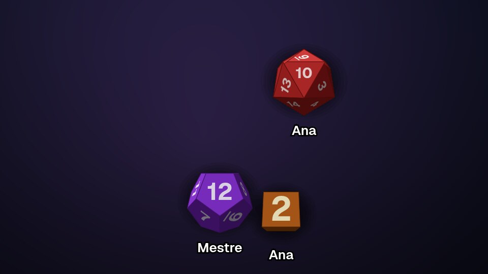
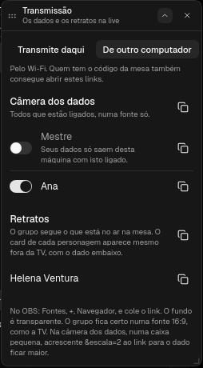

# OBS para o ATO20

Plugin que leva a mesa para a live: os dados do mestre e dos jogadores caindo, e
os retratos dos personagens com vida, condições e o dado de quem jogou embaixo.
Tudo em páginas de fundo transparente, que o OBS captura como fonte de navegador
e põe por cima da cena.



## O que tem aqui

- `main.js` roda no Mestre. Escuta a mesa, tira quem está desligado e publica o
  resto nos canais `dados` e `retratos`. Também desenha o painel **Transmissão**.
- `camera.html` e `camera.js` rodam no navegador do OBS. Assinam o canal, decidem
  o que cai e quando sai, e usam o kit de dados do ATO20 para desenhar.
- `retratos.html` e `retratos.js` fazem o mesmo com os retratos, pelo kit de
  retratos do ATO20.
- `manifest.json` declara o painel, as duas páginas e três ajustes.

## Instalar

No ATO20: Configurações → Plugins → **Catálogo**, e **Instalar** no OBS. O plugin
executa código no Mestre, então o ATO20 pergunta antes. Quando sair versão nova,
o mesmo botão vira **Atualizar**.

Pede o ATO20 com a API de plugins 3 ou mais nova.

Num ATO20 sem o catálogo:

1. Clone o repositório (ou baixe o zip dele):

   ```
   git clone https://github.com/ato20-org/ato20.obs.plugin
   ```

2. No ATO20: Configurações → Plugins → Importar, e escolha a pasta.
3. Habilite o plugin.

## Usar



1. No Mestre, abra **Abas → Transmissão**.
2. Escolha de onde o OBS abre o link: desta máquina ou de outro computador na
   mesma rede.
3. Copie o link:
   - **Câmera dos dados**: todos que estão ligados, numa fonte só.
   - **O link de uma pessoa**: só os dados dela. Serve para pôr o dado de cada
     jogador ao lado da câmera dele no layout.
4. No OBS: Fontes → + → Navegador, cole o link em URL e defina largura e altura
   (1920 × 1080 para a tela inteira, ou uma caixa menor para uma pessoa).

Os interruptores do painel dizem quem aparece, e valem na hora, sem mexer no OBS.
O mestre começa desligado: os dados dele só saem da máquina quando você liga.

### Retratos

Na seção **Retratos** do painel:

- **Retratos no ar**: o grupo, exatamente onde a mesa mostra. Siga o que o mestre
  põe na TV: entra NPC quando ele põe, sai quando ele tira. Use numa fonte 16:9.
- **O card de cada personagem de jogador**: o retrato daquele personagem, com vida,
  condições e o dado do jogador caindo embaixo, encaixado na caixa da fonte.
  Aparece mesmo com o retrato fora da TV.

O retrato mostra o que a mesa vê: medidor e condição escondidos ficam de fora, e o
nome só aparece com a peça "nome" ligada nos retratos da sessão. O dado embaixo
segue o mesmo interruptor da câmera dos dados.

## Ajustes

- Em Configurações → Ajustes → OBS: quantos segundos o dado fica na tela depois
  de parar, e se o nome de quem jogou aparece embaixo dele.
- `&escala=2` no fim do link dobra o tamanho do dado (de 0.5 a 3). Bom para a
  caixa pequena de uma pessoa só.

## O que aparece

- Dados do mestre jogados na mesa do mapa, e os que outros plugins jogam por ele.
  Os do quadro ficam de fora: o quadro é a bancada de trabalho do mestre.
- Dados dos jogadores, pelo celular.
- Só o que foi jogado depois de a fonte abrir. Recarregar a fonte no meio da
  sessão não faz chover os dados que ficaram na mesa.

Com o link de outro computador, quem tem o código da mesa também consegue abrir a
página. Por isso o mestre começa desligado, e o dado de quem está desligado nem
sai do Mestre.
